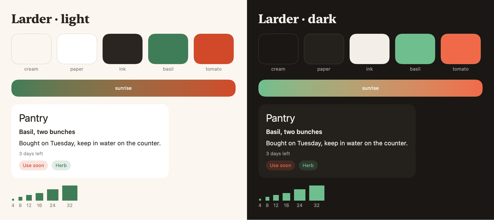
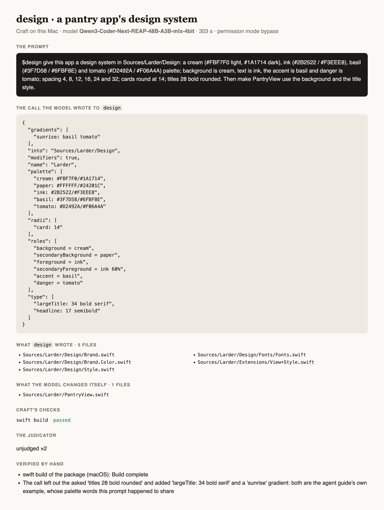
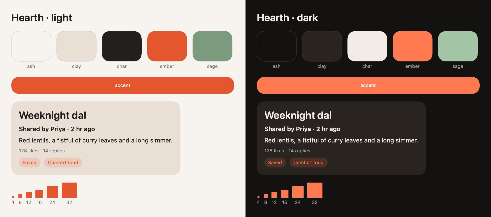
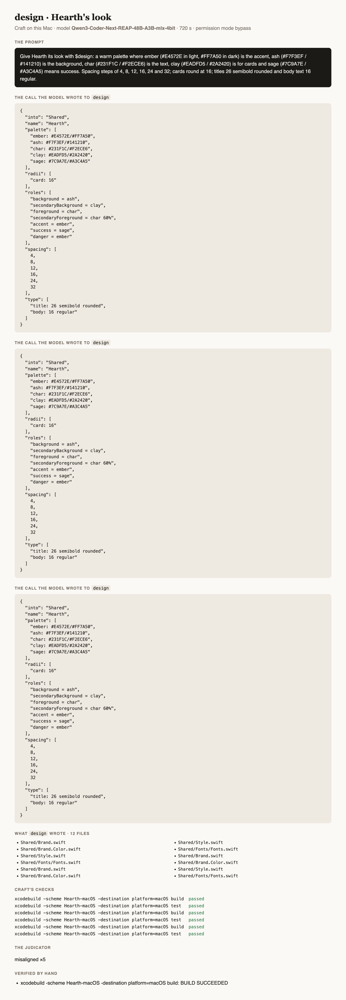

# Testing DesignAgent

How `design` is tested: its own suite, its gated build of real output, and prompts run through
[Craft](https://github.com/riteshpakala/Craft) on a Mac with Craft's own local model, each logged below verbatim with
what came out. A prompt is run as a person would type it, in a project folder, with `$` naming the agent; nothing is
edited between the prompt and the screenshots. A test that needs a server uses mock backend responses, never a live
service.

## The suite

```
swift test                                  # the record, the schema, the lines, the files, a call through the roster
DESIGN_BUILD=1 swift test --filter DesignBuildTests   # the output built for real (gated, minutes)
```

## Prompts run on this Mac

Setup: MacBook Pro M4 Max (128 GB), macOS 27, Xcode 27.1, Craft built from `main`, the model Craft loads
(`rao-studios/Qwen3-Coder-Next-REAP-48B-A3B-mlx-4bit`), permission mode bypass, the agent installed from this repository
with `craft agents add`.

### 1. A pantry app's design system, then a view that uses it

*2026-11-01 · Qwen3-Coder-Next-REAP-48B-A3B-mlx-4bit · 303 s*

**The prompt**, verbatim:

```text
$design give this app a design system in Sources/Larder/Design: a cream (#FBF7F0 light, #1A1714 dark), ink (#2B2522 / #F3EEE8), basil (#3F7D58 / #6FBF8E) and tomato (#D2492A / #F06A4A) palette; background is cream, text is ink, the accent is basil and danger is tomato; spacing 4, 8, 12, 16, 24 and 32; cards round at 14; titles 28 bold rounded. Then make PantryView use the background and the title style.
```

**The call the model wrote** to `design`:

```json
{
  "gradients": [
    "sunrise: basil tomato"
  ],
  "into": "Sources/Larder/Design",
  "modifiers": true,
  "name": "Larder",
  "palette": [
    "cream: #FBF7F0/#1A1714",
    "paper: #FFFFFF/#24201C",
    "ink: #2B2522/#F3EEE8",
    "basil: #3F7D58/#6FBF8E",
    "tomato: #D2492A/#F06A4A"
  ],
  "radii": [
    "card: 14"
  ],
  "roles": [
    "background = cream",
    "secondaryBackground = paper",
    "foreground = ink",
    "secondaryForeground = ink 60%",
    "accent = basil",
    "danger = tomato"
  ],
  "type": [
    "largeTitle: 34 bold serif",
    "headline: 17 semibold"
  ]
}
```

**What `design` wrote** (5 files): `Sources/Larder/Design/Brand.swift`, `Sources/Larder/Design/Brand.Color.swift`, `Sources/Larder/Design/Style.swift`, `Sources/Larder/Design/Fonts/Fonts.swift`, `Sources/Larder/Extensions/View+Style.swift`

**What the model changed itself**: `Sources/Larder/PantryView.swift`

**Craft's checks**: `swift build` passed

**The judicator**: unjudged ×2

**Verified by hand**:
- `swift build` of the package (macOS): Build complete
- The model then used `Color.background` and `.brandTitle` in PantryView, as asked


*What the call wrote, drawn from its own Swift: the palette, the sunrise gradient, the type scale, a card and the spacing layers, in light and dark*


*The outcome card*

**Notes**:
- The call left out the asked 'titles 28 bold rounded' and added 'largeTitle: 34 bold serif' and a 'sunrise' gradient instead: both are the agent guide's own example, and this prompt happened to share the example's palette words (cream, ink, basil, tomato), so the model blended the two. The agent did exactly what the call said. Run 2 below uses words of its own.

### 2. Hearth's warm palette, in a Granite app (the journey's second prompt)

*2026-11-01 · Qwen3-Coder-Next-REAP-48B-A3B-mlx-4bit · 720 s*

**The prompt**, verbatim:

```text
Give Hearth its look with $design: a warm palette where ember (#E4572E in light, #FF7A50 in dark) is the accent, ash (#F7F3EF / #141210) is the background, char (#231F1C / #F2ECE6) is the text, clay (#EADFD5 / #2A2420) is for cards and sage (#7C9A7E / #A3C4A5) means success. Spacing steps of 4, 8, 12, 16, 24 and 32; cards round at 16; titles 26 semibold rounded and body text 16 regular.
```

**The call the model wrote** to `design`:

```json
{
  "into": "Shared",
  "name": "Hearth",
  "palette": [
    "ember: #E4572E/#FF7A50",
    "ash: #F7F3EF/#141210",
    "char: #231F1C/#F2ECE6",
    "clay: #EADFD5/#2A2420",
    "sage: #7C9A7E/#A3C4A5"
  ],
  "radii": [
    "card: 16"
  ],
  "roles": [
    "background = ash",
    "secondaryBackground = clay",
    "foreground = char",
    "secondaryForeground = char 60%",
    "accent = ember",
    "success = sage",
    "danger = ember"
  ],
  "spacing": [
    4,
    8,
    12,
    16,
    24,
    32
  ],
  "type": [
    "title: 26 semibold rounded",
    "body: 16 regular"
  ]
}
```

**The call the model wrote** to `design`:

```json
{
  "into": "Shared",
  "name": "Hearth",
  "palette": [
    "ember: #E4572E/#FF7A50",
    "ash: #F7F3EF/#141210",
    "char: #231F1C/#F2ECE6",
    "clay: #EADFD5/#2A2420",
    "sage: #7C9A7E/#A3C4A5"
  ],
  "radii": [
    "card: 16"
  ],
  "roles": [
    "background = ash",
    "secondaryBackground = clay",
    "foreground = char",
    "secondaryForeground = char 60%",
    "accent = ember",
    "success = sage",
    "danger = ember"
  ],
  "spacing": [
    4,
    8,
    12,
    16,
    24,
    32
  ],
  "type": [
    "title: 26 semibold rounded",
    "body: 16 regular"
  ]
}
```

**The call the model wrote** to `design`:

```json
{
  "into": "Shared",
  "name": "Hearth",
  "palette": [
    "ember: #E4572E/#FF7A50",
    "ash: #F7F3EF/#141210",
    "char: #231F1C/#F2ECE6",
    "clay: #EADFD5/#2A2420",
    "sage: #7C9A7E/#A3C4A5"
  ],
  "radii": [
    "card: 16"
  ],
  "roles": [
    "background = ash",
    "secondaryBackground = clay",
    "foreground = char",
    "secondaryForeground = char 60%",
    "accent = ember",
    "success = sage",
    "danger = ember"
  ],
  "spacing": [
    4,
    8,
    12,
    16,
    24,
    32
  ],
  "type": [
    "title: 26 semibold rounded",
    "body: 16 regular"
  ]
}
```

**What `design` wrote** (12 files): `Shared/Brand.swift`, `Shared/Brand.Color.swift`, `Shared/Style.swift`, `Shared/Fonts/Fonts.swift`, `Shared/Brand.swift`, `Shared/Brand.Color.swift`, `Shared/Style.swift`, `Shared/Fonts/Fonts.swift`, `Shared/Brand.swift`, `Shared/Brand.Color.swift`, `Shared/Style.swift`, `Shared/Fonts/Fonts.swift`

**Craft's checks**: `xcodebuild -scheme Hearth-macOS -destination platform=macOS build` passed; `xcodebuild -scheme Hearth-macOS -destination platform=macOS test` passed; `xcodebuild -scheme Hearth-macOS -destination platform=macOS build` passed; `xcodebuild -scheme Hearth-macOS -destination platform=macOS test` passed; `xcodebuild -scheme Hearth-macOS -destination platform=macOS build` passed; `xcodebuild -scheme Hearth-macOS -destination platform=macOS test` passed

**The judicator**: misaligned ×5

**Verified by hand**:
- `xcodebuild -scheme Hearth-macOS -destination platform=macOS build`: BUILD SUCCEEDED; Craft's own build and test checks by the scheme passed 6 of 6


*What the call wrote, drawn from Hearth's own generated Swift: the palette, the accent, the rounded semibold title, a card and the spacing layers, in light and dark*


*The outcome card*

**Notes**:
- With words of its own, the call is faithful to the prompt: every colour, role, spacing step, the card radius and both type lines as asked. It added one role nobody asked for, `danger = ember`.
- The model passed `into: Shared`, so the files landed loose in Shared/ instead of Shared/Design/ (the default when `into` is left out). In a Loom-layout app only App.swift and AppDelegate.swift belong loose in Shared/; the agent now writes into Shared/Design when pointed at Shared itself (see the release after this run).
- Craft's judicator read the work as misaligned five times (it said the spacing, radius and type styles were not defined; all are in Style.swift) and the model called design three times with the same call. A judicator finding, reported.
